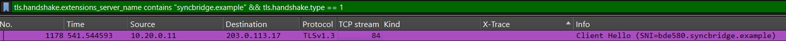

# Which App is Calling Home?

### Objective & Technique
The objective of this lab is to identify all HTTPS connections generated by malware within a 30-minute network capture involving 10–14 PCs. IP filtering is insufficient because the post-handshake payload is encrypted and multiple applications share the same IP addresses. To overcome this, we use the **JA4** technique to identify the underlying TLS library used by the malware.

### Locating the Anchor Connection
First, I isolated the initial C2 connection using the following display filter:

tls.handshake.extensions_server_name contains "syncbridge.example" && tls.handshake.type == 1

This filter was chosen because threat intelligence reports identified *syncbridge.example* as a Command-and-Control (C2) domain. This query successfully returned the single required ClientHello packet.

### Extracting the JA4 Fingerprint
By inspecting the TLS details of this packet, I extracted the **JA4** fingerprint field and applied it as a global display filter.

### Isolating Malware Connections & Flag Reconstruction
Applying the JA4 filter successfully matched all 8 connections originated by the malware across the capture.

By extracting the first label of the SNI (6 hex digits) from each of the 8 packets in capture order and concatenating them, I obtained the final flag:

**netsec{680f645c7411bde580fb4331d0366677c3985cbac6eb91d2}**

