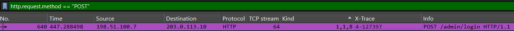
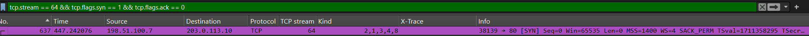
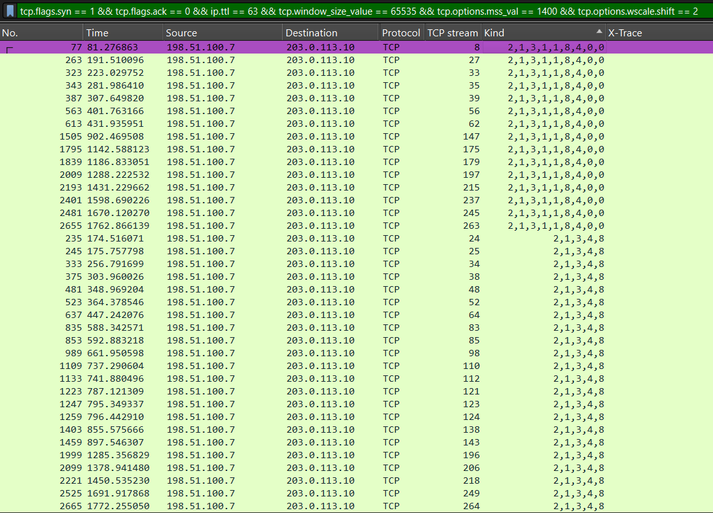
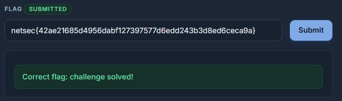

# Who is Behind the NAT?

## Objective & Technique
The objective of this lab is to analyze a WAN-side capture from a small office NAT router and isolate all connections made by the client PC that executed the single **POST /admin/login** request. 

To complete this challenge, I selected **Technique 2: SYN Signature (p0f-style)**. This approach identifies the target host by inspecting static TCP/IP parameters that pass through the NAT unchanged.

## Analysis

### Locating the Anchor Request
The capture file was loaded into Wireshark. To find the initial administrator authentication request, I applied the following display filter:

http.request.method == "POST"

This filter returned a single packet containing **POST /admin/login**. Inspecting its details showed that it belonged to **TCP stream 64**.

### Extracting the SYN Signature
To find the initial handshake of this connection, I retrieved the client's SYN packet using:

tcp.stream == 64 && tcp.flags.syn == 1 && tcp.flags.ack == 0

Inspecting the IP and TCP headers of this packet revealed the host's signature parameters:
- **IP TTL:** 63
- **TCP Window Size:** 65535
- **MSS:** 1400
- **Window Scale:** 2
- **TCP Options Order (Kind):** 2,1,3,4,8

 
 

### Filtering Candidate Connections
Using the extracted parameters, I constructed a display filter to find all SYN packets matching this initial profile:

tcp.flags.syn == 1 && tcp.flags.ack == 0 && ip.ttl == 63 && tcp.window_size_value == 65535 && tcp.options.mss_val == 1400 && tcp.options.wscale.shift == 2

Sorting the results by the **Kind** column (TCP option ordering) revealed two distinct groups of devices sharing the same TTL and Window Size. Comparing the option order against our anchor SYN (2,1,3,4,8), I isolated the exact set of streams belonging exclusively to the admin's PC.

### Extracting X-Trace Headers & Flag Reconstruction
I then filtered for HTTP requests across all verified streams belonging to the admin's PC:

http.request && tcp.stream in {9, 13, 21, 27, 41, 49, 55, 64, 67, 74, 80, 83, 96, 101, 112, 115, 116, 140, 149, 160, 179, 184, 201}

Inspecting the **X-Trace** header column displayed 8 unique trace fragments indexed from n=1 to n=8.

Concatenating these fragments in numerical order from 1 to 8 yielded the final flag:

**netsec{42ae21685d4956dabf127397577d6edd243b3d8ed6ceca9a}**

